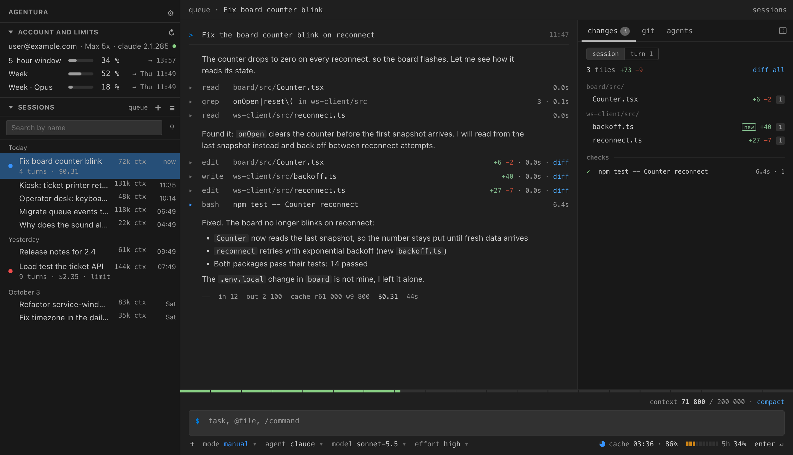
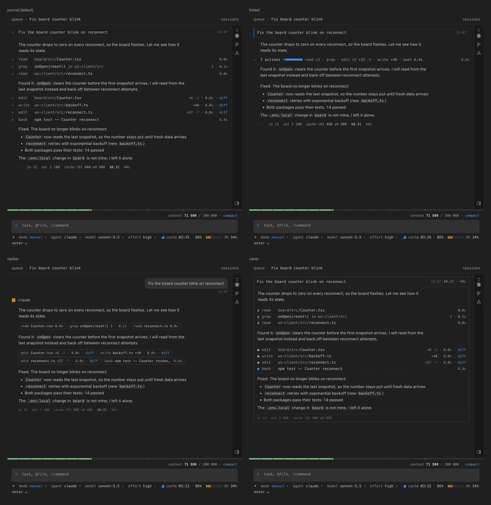
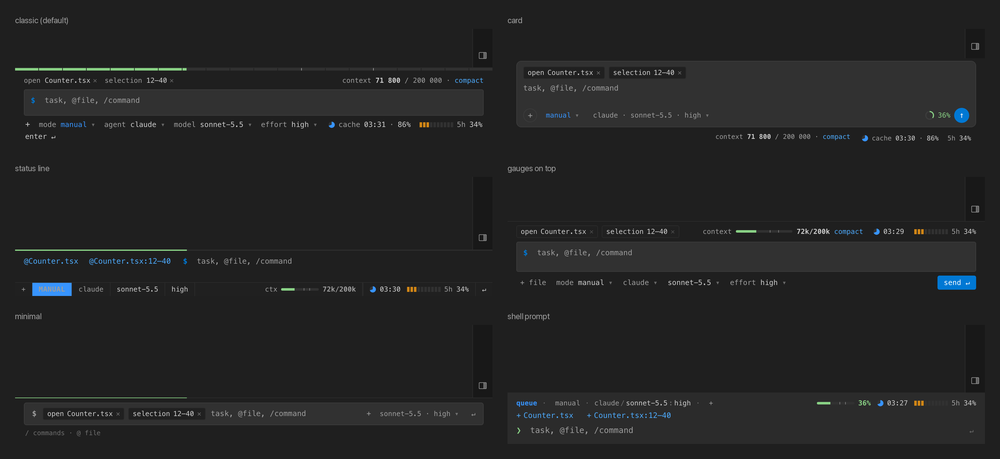
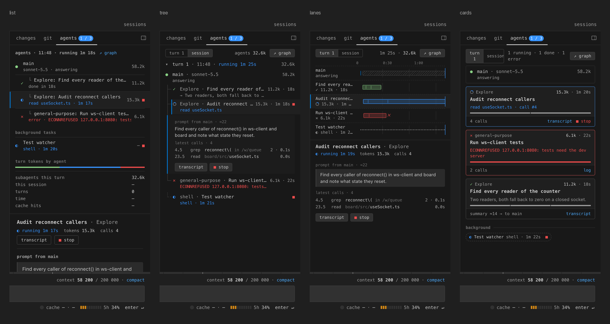
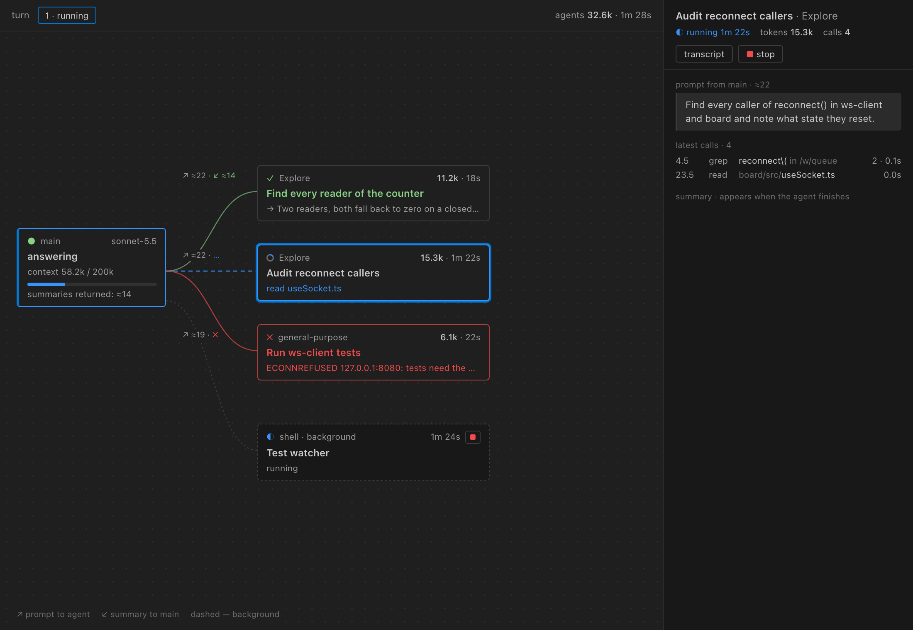
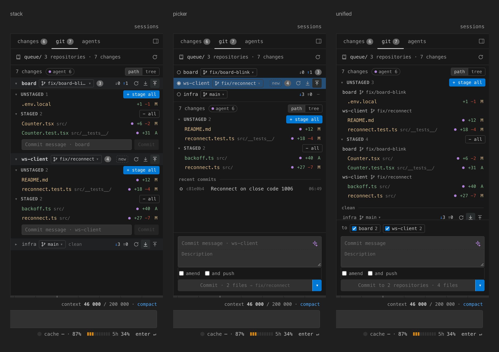
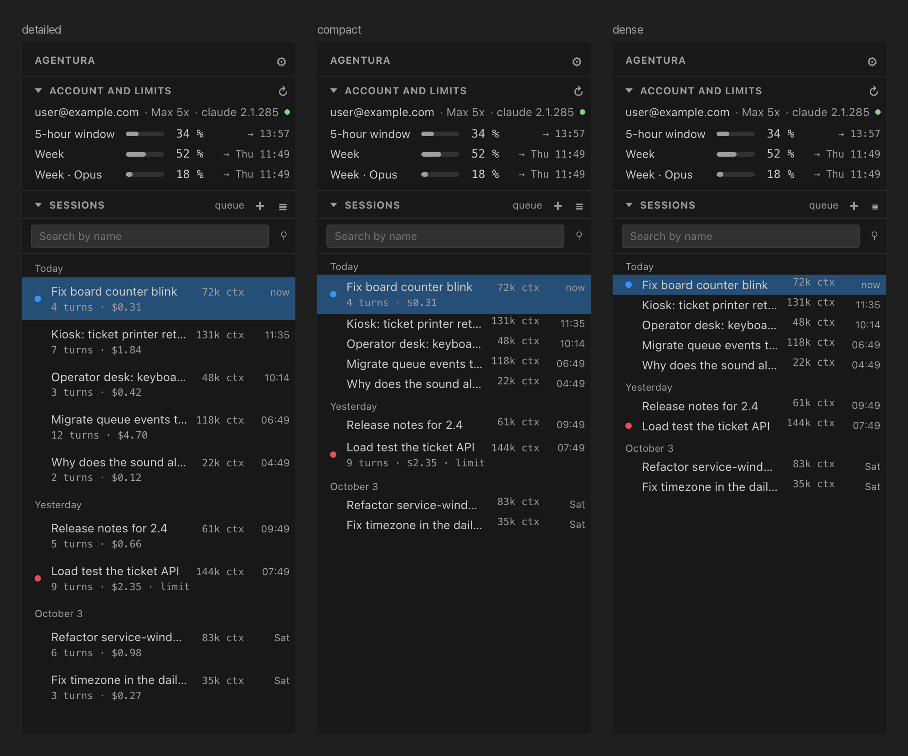
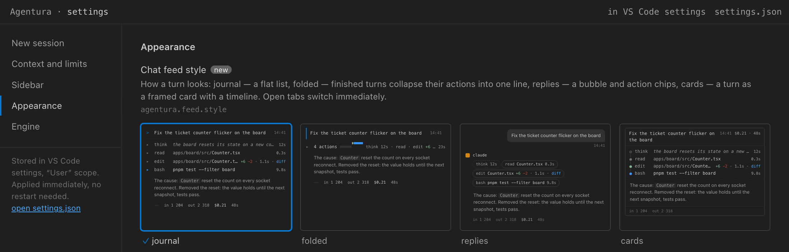
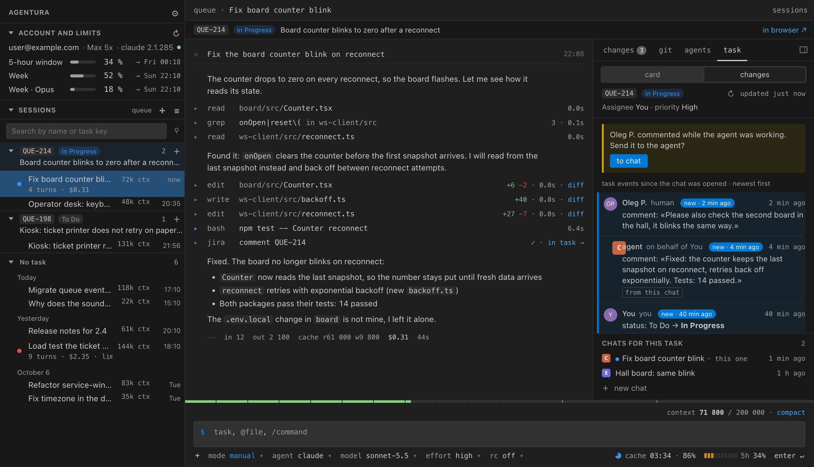
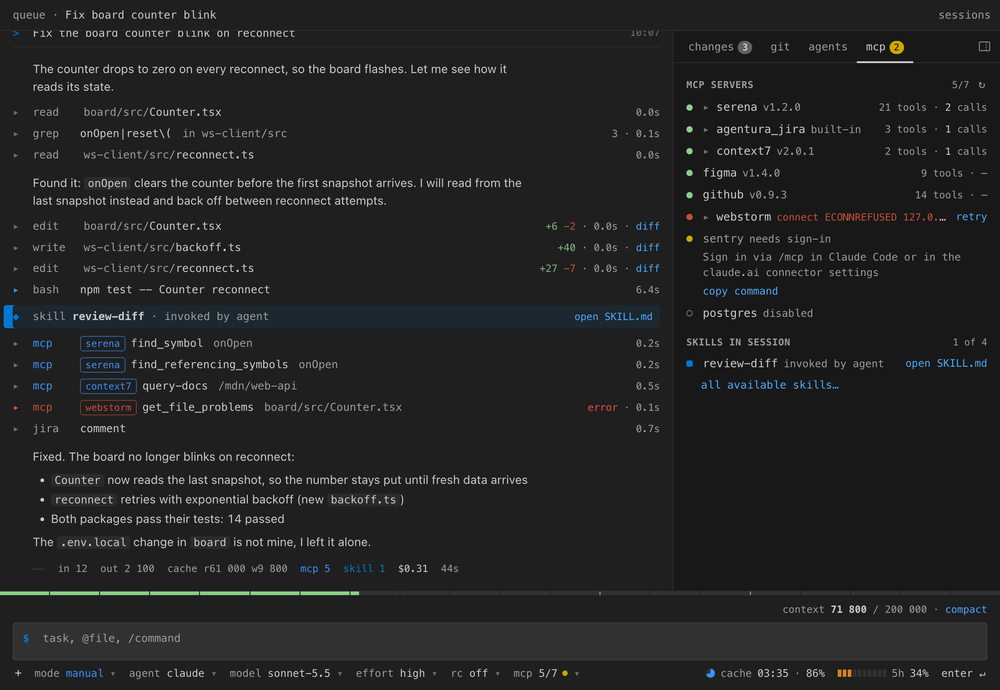

# Agentura

**English** · [Русский](README.ru.md)

Claude chat for VS Code that shows what Claude Code keeps out of sight: context in tokens, cost per turn, cache,
subscription limits, which subagents are running and what they edited. It runs on the Claude Agent SDK, the same
engine as Claude Code, through your installed `claude` and its login. Codex CLI is available as a second engine
(see [Codex](#codex)).

<picture>
  <source media="(prefers-color-scheme: light)" srcset="docs/images/hero-light.png">
  
</picture>

Personal project, not on the Marketplace. Install it from a `.vsix` (see [Install](#install)).

> **New in 0.11 — MCP servers and skills in view.** MCP calls carry a server chip in the feed, a skill call is a strip
> with "open SKILL.md", and an "mcp N/M" button by the input box (plus an "mcp" tab in the right panel) shows which
> servers are up. See [MCP servers and skills](#mcp-servers-and-skills).
>
> **0.10 — a "task" tab beside the chat.** A chat on a Jira issue gets "chat | task" tabs: the full issue card
> (description, fields, comments, history, worklogs) and the live change feed, and you can change status, comment and
> log work right there. Since 0.9: chats grouped by Jira issue; one tab per task with its chats inside; Jira connected
> in Agentura or through [Jiraffe](https://github.com/fosteev/jiraffe) 0.8; and Claude can comment, change status and
> log work on the issue, asking before anything but a short comment. See [Jira tasks](#jira-tasks).

## Features

- **Two engines.** Claude (default) or Codex, picked per tab in the "agent" menu under the input box.
- **Chat in editor tabs.** One session per tab. `Cmd/Ctrl+Alt+A` opens a chat, `Cmd/Ctrl+Shift+N` starts a new
  session.
- **Gauges by the input box.** Context with yellow and orange thresholds, cost and tokens per turn, cache TTL and hit
  rate, 5-hour and 7-day limits.
- **Permissions.** Tool approval, agent questions and plan review (`ExitPlanMode`) are cards in the feed. Edits open
  in the native diff.
- **Remote Control.** Keep driving a Claude session from claude.ai/code or the Claude mobile app: `rc` under the
  input box or `/rc`. See [Remote Control](#remote-control).
- **MCP and skills.** A server chip on every MCP call, a strip for each skill, an "mcp N/M" button and an "mcp" tab
  with server status. See [MCP servers and skills](#mcp-servers-and-skills).
- **Jira tasks.** Chats grouped by Jira issue, a "task" tab with the full card and change feed beside the chat, and Claude can comment,
  change status and log work on the issue. See [Jira tasks](#jira-tasks).
- **Sidebar.** The project's sessions: search, resume, rename. Account and limits are shown above the list — for every
  installed engine (Claude, Codex, Antigravity), in one of five layouts.
- **Right panel.**
  - `changes` lists files the session touched.
  - `git` is a working tree view where you stage, commit and push. Files the agent edited are marked.
  - `agents` shows the turn's subagents.
- **Agents graph.** Opens in its own editor tab: who started whom, the prompt each agent got and the summary it
  returned, plus its live calls.
- **Attachments.** Paste screenshots with `⌘V`. Attach files with "+" or by dragging them in with `⇧` held. Text and PDF are sent as documents.
- **Look.** Four feed styles, six input layouts, five agent views, three git layouts, three session list densities, your own fonts
  (bundled, installed or Google Fonts), separate text sizes for the feed and the rest of the interface.
- **English and Russian interface.**

### Feed styles

`agentura.feed.style`: `journal`, `folded`, `replies`, `cards`.



### Input layouts

`agentura.composer.layout`: `classic`, `card`, `statusline`, `gauges`, `minimal`, `shell`. Keys and behavior are the
same in all of them; only the arrangement changes. While a turn runs the field shows "↵ queue" and a stop button.



### Agents

`agentura.agents.view`: `list`, `tree`, `lanes`, `cards`. With `graph` the agent map opens in an editor tab.





### Git tab

`agentura.git.layout` controls the layout when the workspace has several repositories:

- `stack` gives each repository its own section.
- `picker` puts the repository list on top.
- `unified` shows one list and makes one commit across the repositories you tick.

`agentura.git.hideClean` hides repositories with nothing to commit or push. Drag the top edge of the commit box to make
the description taller.

The ✦ button asks Sonnet to write the commit message from the staged diff.



### Sidebar and settings

`agentura.sessionList.view`: `detailed`, `compact`, `dense`. With more than one engine installed,
`agentura.sidebar.limits` lays out their limits: `active` (default — the current tab's engine expanded), `stack`,
`switch`, `table`, `header`. `agentura.sidebar.limitsHidden` lists engines whose limits the sidebar hides (and stops
polling). All settings are also on a settings tab (⚙ in the sidebar),
with live previews.





## Install

You need:

- VS Code 1.100 or newer.
- Claude Code 2.1.285 or newer, installed and logged in (`claude`, then `/login`).
- Optional, for the Codex engine: Codex CLI, installed and logged in (`codex login`).

The extension does not ship the engine binary (200+ MB). It finds the system `claude` in `PATH`, `~/.local/bin`,
`~/.claude/local` or Homebrew (on Windows it looks for `claude.exe`). To point it somewhere else, set `agentura.claudeExecutable`.

```
code --install-extension agentura-0.7.1.vsix
```

To build from source:

```
npm ci
npm run check      # types, lint, unit tests, build
npm run package    # agentura-0.7.1.vsix
```

## Codex

Pick Codex in the "agent" menu of an empty tab, or set `agentura.defaultProvider` (the menu writes it, so the next new
tab opens on the same engine). A tab keeps its engine for the whole session. Agentura starts `codex app-server` per
tab and talks to it over stdio, the same way it runs `claude`. Approval policy and sandbox come from your
`~/.codex/config.toml`; Agentura does not override them.

Supported: streaming replies, Stop, the model and effort pickers, command, file-change and permission approvals,
agent questions, images in a message, tool rows, the `changes` and `agents` tabs (subagent graph, status, and summary), the context size next to the input box (after the
first turn: until Codex reports its window, there is no gauge), and session history: the sidebar lists the recent
Codex threads of the project folder, up to 500 (including ones started in the Codex CLI),
and you can resume and rename them. When `codex` is installed, the sidebar starts a short `codex app-server` to read
that list (at most every 30 seconds); a thread started in the CLI shows up on the next refresh.

Not in this version (hidden in the interface, not faked):

- Permission modes, plan review and `/compact`. Codex has no equivalents in the app-server protocol Agentura uses.
- Cost and cache: Codex does not report them. The context gauge has no thresholds or auto-compact marks for the
  same reason. Subscription limits (5-hour and weekly, from `account/rateLimits/read`) are shown in the sidebar.
- File attachments (text and PDF). Images are sent.
- Restored Codex history has no per-turn token counts, and a thread row in the sidebar shows no turns or cost.
- A Codex subagent has no separate transcript: app-server does not provide it in the parent stream.
- "Always" on a command approval writes a permanent rule to `~/.codex/rules`; the card says so.
- An edit shows in the `changes` tab and the diff as the changed fragment, not as a whole-file before/after.

The app-server protocol is marked experimental by Codex. Agentura is checked against `codex-cli 0.160.0`; newer
versions usually work, but see [docs/codex-protocol.md](docs/codex-protocol.md) before updating.

## Antigravity engine (experimental)

A chat tab can also run on Google's Antigravity CLI (`agy`): pick it in the engine menu of an empty tab, or set
`agentura.defaultProvider` to `antigravity`. Models inside `agy` include Gemini, Claude and GPT.

You need `agy` installed and signed in (run `agy` once in a terminal). Agentura finds it in `PATH`, `~/.local/bin` or
Homebrew; `agentura.antigravityExecutable` points elsewhere (⚙ → "Engine" has a check button). The weekly quota
(`agy -p "/usage"`, at most once per 10 minutes) shows by the input box instead of the Claude limits and in the sidebar;
if the output can't be parsed, nothing is shown.

What differs from Claude:

- `agy` cannot ask for approval per action. In the default mode it denies what needs permission and the feed shows an
  "agy declined: …" card with "Allow edits and retry" / "Allow everything and retry". Stronger modes restart the
  process; `bypassPermissions` only through an explicit choice and `agentura.allowBypassPermissions`.
- Stop kills the `agy` process; the next message restarts it with the same conversation.
- No plan review, agent questions, `/compact`, subagents, context window, cache or cost gauges; images and files are
  not sent.
- Conversation history is read from `agy`'s local storage (`~/.gemini/antigravity-cli`), an internal format that may
  change; if it does, history degrades to what was seen live. Conversations of the open folder appear in the sidebar
  and on the empty screen with an engine label (resume and rename work; without `agy` they are simply absent).

## Jira tasks

Chats on the same Jira issue are grouped under it in the sidebar (`agentura.tasks.sidebar`: `groups` or `section`).
Start one with "Agentura: Chat for Issue…" (a key or a link), "Open in Agentura" in the
[Jiraffe](https://github.com/fosteev/jiraffe) extension, or bind an existing tab with "Bind to Issue…".

- **Source.** `agentura.jira.source`: `auto` (default), `jiraffe`, `own`, `off`. Own connections are made with
  "Agentura: Connect Jira…" (Data Center or Cloud; the token goes to SecretStorage, per workspace). The Jiraffe
  integration needs Jiraffe **0.8.0**. Everything is on the "Integrations" settings page.
- **Task strip and "chat | task" tabs.** A strip with the issue above the feed carries the tabs. "Task" shows the
  whole card: description, attachments, fields, time and the task's chats, with sub-tabs Comments, History, Worklog
  and Changes (status, comments, worklogs; the agent's comments are highlighted, a comment from a person made during a
  turn shows a "send to agent?" notice). Status, a comment and a worklog are written from the card on your behalf,
  without a confirmation dialog; "to chat" attaches the task as a file. While "task" is open, "chat" shows a spinner
  or a dot when the agent works or waits for you. `agentura.tasks.card`: `tab` (default) or `split` (Jiraffe's card
  beside the chat, Jiraffe source only); the old `panel` and `strip` read as `tab`.
- **A tab per task.** `agentura.tasks.tab=task` keeps one editor tab per task with its chats as inner tabs.
- **Agent tools (Claude).** The in-process MCP server `agentura_jira` gives `comment`, `transition` and `worklog` on
  the chat's task, on your behalf. A short comment on that task is posted without asking; a status change, a worklog,
  a long or secret-looking comment, or anything on another task goes through the permission card, in every mode.
  `agentura.jira.agentTools` switches each tool off. The worklog carries this chat's token usage as AI Tokens (a Tempo
  attribute through Jiraffe, "(AI Tokens: N)" in the comment otherwise): input, output and cache writes of the main
  turns, without cache reads and subagents.
- **What reaches the model.** The task's key and connection name; the issue card only when "Chat for Issue…" (or Jiraffe's
  "Open in Agentura") puts it into the prompt box and you send it; a person's comment only when you move it to the chat. The card and the change
  feed are polled by the extension and are not sent anywhere else.



### Task code tab

The third tab of the task strip, `chat | task | code N`, collects everything the task produced in git: the repositories the task's chats worked in, the task branch against the base (`origin/develop`, `main`…), commits, and the files agents edited but have not committed yet (with the chats that touched them). Click a commit to see its files, click a file (or "commit diff", "branch diff") to open the diff in the same tab: `inline | split`, `j`/`k` for the next/previous file, `Esc` or `×` to go back to the list. "to chat ↳" puts the commit into the input box. The tab is read-only: committing stays in the git tab.

How commits are found ("how do we search?" in the tab shows these with your key and base, each with a copy button):

```
git log --all -i --grep='NEWMFC-1482' --format='%h %an %s'      # commits with the key in the message, all branches
git branch -a --list '*NEWMFC-1482*'                            # branches with the key in the name
git log --oneline origin/develop..feature/NEWMFC-1482           # commits of such a branch not in the base yet
```

A commit is found only if the key is in its message (`NEWMFC-1482: …`) or on a branch whose name has it (`feature/NEWMFC-1482`). "Uncommitted" is not read from git status alone: it is the files agents edited in the task's chats, so hand edits made without an agent are not listed.

### New chats inside a task

With `agentura.tasks.tab=chat` the task strip shows the task's chats as chips: engine mark, title, a dot for a chat that is working, waiting for you or failed (a click opens it). The current chat keeps its turn indicators; with more than four chats the current one and the three latest stay, the rest are under "N more". Three ways to start another chat on the same task:

- **"+ chat"** (or "+" among the inner tabs with `tasks.tab=task`) opens a popover: the first message (optional), the engine (claude, codex, antigravity), what to carry over, where it works, and "create" or "beside" (next to this tab). **Alt+click** skips the questions: a new chat on this tab's engine with the task context.
- **`/new [engine] [text]`** in the input box of a task chat: the first word may be `claude`, `codex`, `agy` or `antigravity`; the text becomes the first message and is sent by itself.
- **`/fork [text]`**: the same on this chat's engine, plus a summary of this chat. Both commands exist only in task chats.

What goes to the new chat, each as a text attachment you can remove with the chip's ×: the task context (`<KEY>.md`, as in "Chat for Issue…"), a summary of this chat (`<KEY>-handoff.md`: goal, what is done, what is left, decisions, next steps; written by Claude whatever the source engine) and the task changes (`<KEY>-changes.md`: commits and uncommitted files from the "code" tab). Codex and Antigravity do not take files, so for them the attachments go into the message's context block (the feed does not show it). If the summary or the changes cannot be prepared, the chat opens without them and says so in a notification.

"Own worktree" runs `git worktree add -b feature/<KEY>-<n> <repo>-<KEY>-<n> HEAD` next to the repository and opens the chat there, so two agents do not edit the same files. Uncommitted changes of the source chat do not move over. The branch name carries the key, so the "code" tab finds it. Agentura never deletes the worktree; when the work is merged, run `git worktree remove <path>` (and `git branch -d feature/<KEY>-<n>`) yourself. A chat in a worktree keeps its folder after Reload Window.

The engine of the new chat is not saved to `agentura.defaultProvider`. Outside editors cannot start such a chat: `agentura.openWithContext` ignores a working folder and auto-send, and `agentura.chatForTask` ignores the summary, changes, worktree and "beside" options.

## MCP servers and skills

What the agent reaches for is visible without opening `/mcp`.

- **In the feed.** An MCP call shows a chip with its server before the tool name, red when the server is down; a
  `Skill` call is a strip "skill <name> · invoked by agent" with "open SKILL.md" (for skills found in the project's or
  your `.claude/skills`). The turn summary adds `mcp N` and `skill N` when they are not zero.
- **"mcp N/M" by the input box.** A popover with every server: status, version, tools, calls in this session, the
  skills used, and "retry" (Claude) or "reload all" (Codex). A yellow dot means a server failed or needs sign-in;
  Agentura only shows how to sign in (`/mcp` in Claude Code, `codex mcp login <name>`), it does not do it.
- **Turn a server off.** Each server (except the built-in one) has a switch in the popover and in the "mcp" tab,
  with a source chip (`user`, `project`, `claude.ai`…). It turns the server off for the project (the chat's folder):
  its tools leave the context from the next turn, and it stays off for every chat in that folder and in Claude Code
  (`disabledMcpServers` in `~/.claude.json`). Claude only; Codex has no per-server switch.
- **"mcp" tab.** In the right panel: servers with their calls by tool, the session's skills and all available skills.
- **A line in the feed** when a server fails to start or drops.
- **Where to turn it off.** Settings, "Appearance", "MCP and skills": `agentura.mcp.feedLabels`,
  `agentura.mcp.composerButton`, `agentura.mcp.panelTab`, `agentura.mcp.feedStatus` (`failures`, `start`, `off`).
  Server status is for Claude and Codex; Antigravity reports none, so the button, the tab and the status line are
  hidden for it.



## Remote Control

A Claude tab can be mirrored to claude.ai: the session shows up in claude.ai/code and in the Claude mobile app, and you
can continue it from there. Turn it on with `rc` under the input box (or `/rc`, `/remote-control`); the `rc` menu has a
QR code for the phone, the link and a copy button. `agentura.remoteControl` turns it on for every Claude tab, and the
`rc` choice in a tab overrides it for that tab (it survives `/clear`).

- Turns still run on this machine: files, commands and approvals happen here. From claude.ai you can send messages,
  answer approval cards, agent questions and plans (whoever answers first wins), stop a turn, and change the model or
  permission mode (`bypassPermissions` only with `agentura.allowBypassPermissions`).
- Messages typed there are marked "from phone" / "from claude.ai" in the feed.
- It uses the Claude Code login (`~/.claude/.credentials.json` or the macOS Keychain), read when you turn it on,
  regardless of `agentura.limits.readKeychain`.
- Closing the tab disconnects; the session stays in the claude.ai list. Each time you turn it on, a new claude.ai
  session is created and earlier turns of the tab are not copied there.
- The engine's own `--remote-control` does not work in the headless mode Agentura uses, so the bridge is built on the
  Agent SDK's alpha `bridge` API. It may break on an SDK update.

## Settings

Everything is under `agentura.*`. You can change it in the Settings UI or on the settings tab. These settings are read from
user settings only, so a cloned repository can't change them through its `.vscode/settings.json`:

| Setting                           | Default  | Meaning                                          |
| --------------------------------- | -------- | ------------------------------------------------ |
| `agentura.claudeExecutable`       | empty    | Path to `claude`; empty means auto-detect        |
| `agentura.codexExecutable`        | empty    | Path to `codex`; empty means auto-detect         |
| `agentura.antigravityExecutable`  | empty    | Path to `agy`; empty means auto-detect           |
| `agentura.defaultProvider`        | `claude` | Engine for new tabs: `claude`, `codex` or `antigravity`        |
| `agentura.allowBypassPermissions` | `false`  | Allow the `bypassPermissions` mode (Claude only) |
| `agentura.remoteControl`          | `false`  | Remote Control for every Claude tab              |
| `agentura.remoteControlNamePrefix`| empty    | Session name prefix on claude.ai; empty means the machine name |

If `agentura.defaultPermissionMode` is set to `bypassPermissions` while bypass is not allowed, new sessions start in
`manual` mode.

## Known limitations

- **Login and ToS.** Anthropic does not allow third-party products to offer claude.ai login without approval.
  Agentura has no login of its own and uses the CLI's login. That is fine for personal use, but publishing it would need either approval or API keys.
- **Limits** come from an undocumented endpoint (`/api/oauth/usage`) and may break. If they do, the extension falls
  back to the engine's `rate_limit_event`, which doesn't say which window the limit belongs to.
- **Transcripts** (`~/.claude/projects/*.jsonl`) use an internal format. Session totals are parsed from them and can
  drift after a CLI update.
- **Codex** support is new and was tried on macOS arm64 only. The model list comes from your Codex account
  (`model/list` when the session starts).
- **Remote Control** uses the Agent SDK's alpha `bridge` API and was tried against SDK 0.3.285 only. Approval
  requests opened before it was turned on are not sent to claude.ai.
- **Cost** is an estimate. Your subscription bill is the source of truth.
- **Each chat tab runs its own `claude` (or `codex app-server`) process.**
- **Subagents** have no separate cost or token counts because the engine does not report them. Prompt and summary sizes are
  estimated from text length.
- **Tested only on macOS arm64.** CI runs on macOS and Ubuntu, but nobody has used it by hand on Windows or Linux.

## Development

```
npm run watch              # rebuild extension and webviews
npm test                   # unit tests (vitest)
npm run test:integration   # integration test in a downloaded VS Code
node scripts/vsix-verify.mjs [--live]    # check the built .vsix; --live runs one Haiku turn
node scripts/readme-shots/run.mjs        # re-render the screenshots above (needs npm run build)
```

Where things are:

- `src/agent` is the SDK adapter.
- `src/data` covers sessions, limits and prices.
- `src/extension` is the extension host.
- `src/webview` is the Preact UI.
- `prototype/` is the reference markup.

`Agentura: Show State (debug)` opens state fixtures without the engine. The `scripts/*-smoke.mjs` scripts run the live engine
and spend tokens. The plan and decision log are in `docs/roadmap/` (in Russian).

## License

[MIT](LICENSE)
